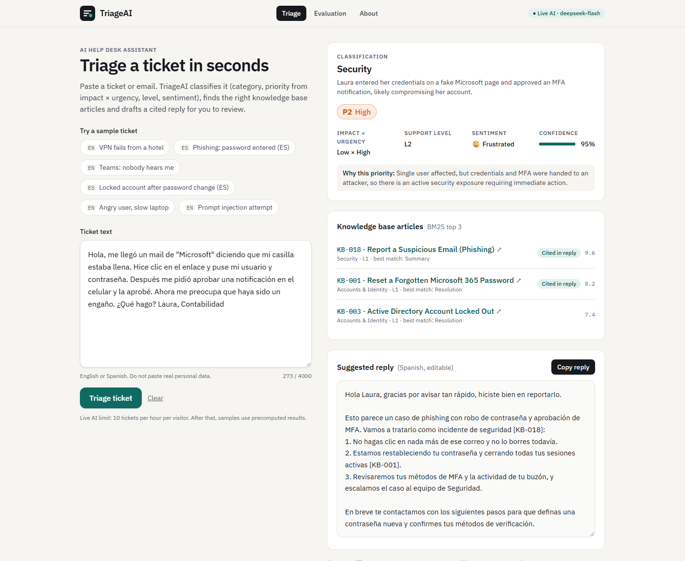
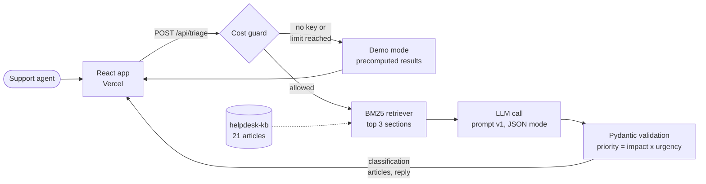
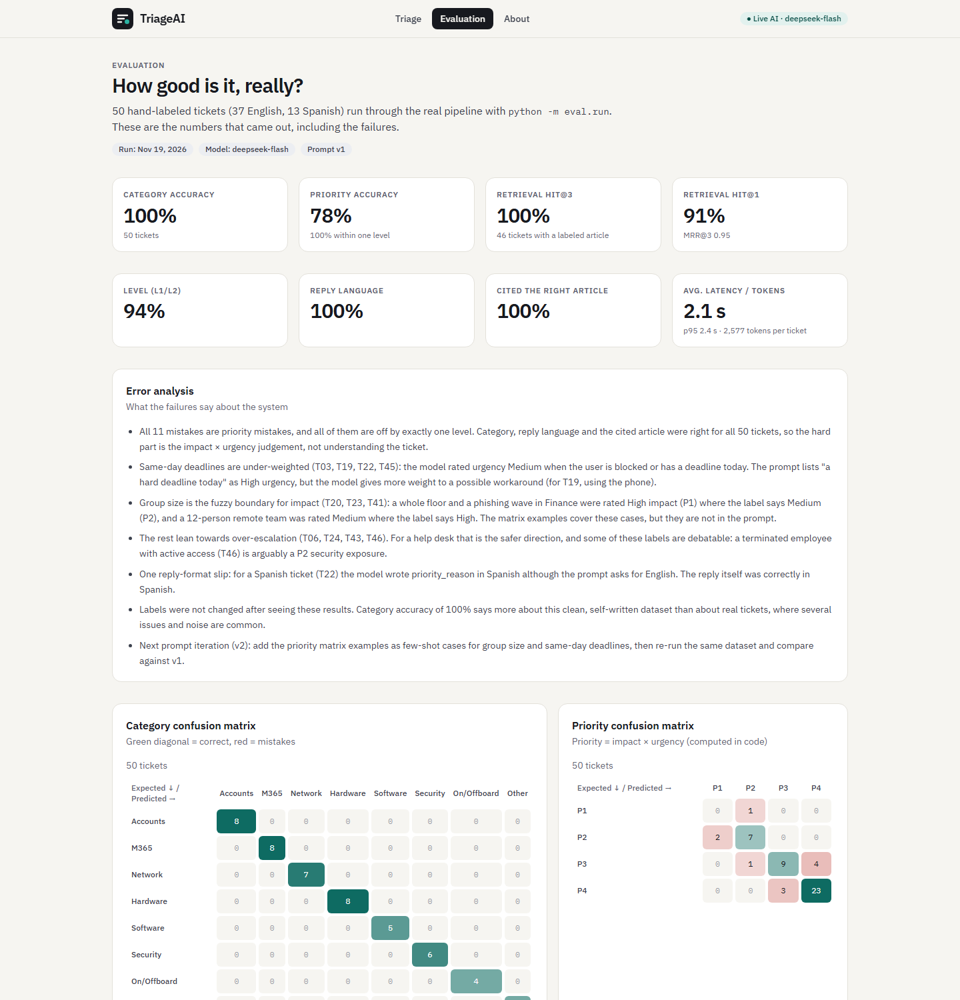

# TriageAI

**An AI assistant for IT help desks: it classifies a ticket, finds the right knowledge base articles and drafts a cited reply, with an evaluation page that shows how often it is right.**

[](https://github.com/lucaswsanchez/triage-ai/actions/workflows/ci.yml)
[](LICENSE)


<h3 align="center">
  <a href="https://triage-ai-roan.vercel.app">▶ Live Demo</a> &nbsp;·&nbsp;
  <a href="https://triage-ai-api-j687.onrender.com/docs">📘 API Docs (Swagger)</a> &nbsp;·&nbsp;
  <a href="https://triage-ai-roan.vercel.app/evaluation">📊 Evaluation results</a>
</h3>

> The API runs on Render's free tier: **the first request may take ~50 s (free tier cold start)**. The web app pings it on load to wake it up.



## Features

- **Ticket triage** in English or Spanish: category, **priority computed from impact × urgency** with a documented matrix, support level (L1/L2), sentiment and model confidence.
- **Retrieval-augmented replies**: BM25 search over the [helpdesk-kb](https://github.com/lucaswsanchez/helpdesk-kb) knowledge base (21 articles), and a draft reply that cites the articles it used, each linked to the [KB site](https://lucaswsanchez.github.io/helpdesk-kb/). The reply is editable and has a copy button.
- **Structured output you can trust**: JSON mode validated with Pydantic, one retry on invalid output, citations not in the retrieved set are dropped.
- **Prompt injection defenses**: delimited ticket, instruction hierarchy, model flag plus a heuristic detector, refusal of off-topic requests. 3 attack cases documented and tested.
- **Demo mode that never breaks**: without an API key, after the hourly limit or when the daily budget is spent, the sample tickets return precomputed real results and other tickets get the KB search, with a clear *Demo mode* badge.
- **Cost protection**: 10 live requests per hour per IP, a global daily budget, a 4,000-character input limit and `max_tokens=700`. The API key lives only on the backend.
- **Evaluation page**: 50 hand-labeled tickets, category and priority accuracy, confusion matrices, retrieval hit rate@3 and every failed example, with an honest error analysis.
- **Transparency**: latency, token usage, model and prompt version on every result.

## Tech Stack

| Layer | Technology |
|---|---|
| Backend | Python 3.12, FastAPI, Pydantic v2, pydantic-settings |
| LLM | DeepSeek `deepseek-flash` through the OpenAI SDK (any OpenAI-compatible API via env vars) |
| Retrieval | rank_bm25, section-level chunking of Markdown + YAML front matter |
| Frontend | React 19, Vite, TypeScript, Tailwind CSS v4, React Router, Mermaid |
| Quality | pytest (LLM mocked), ruff, oxlint, Prettier, Vitest, GitHub Actions |
| Deploy | Render (API, free plan, Blueprint), Vercel (web) |

## Architecture



```text
backend/
  app/            FastAPI app: config, kb, retrieval, llm, prompting, priority, triage, ratelimit
  data/           KB articles and priority matrix copied from helpdesk-kb, sample tickets, demo results
  prompts/        v1 system prompt + few-shot, DECISIONS.md, prompt injection cases
  eval/           dataset.jsonl (50 tickets), run.py, results.json
  scripts/        sync_kb.py (refresh KB), build_demo.py (record demo results)
  tests/          pytest suite (no network)
frontend/
  src/pages/      Triage, Evaluation, About
  src/components/ UI pieces, confusion matrix, Mermaid
```

## Getting Started

### Without Docker

Requirements: Python 3.12, Node 22+ and pnpm.

```bash
# API (http://127.0.0.1:8000, docs at /docs)
cd backend
python -m venv .venv
.venv/Scripts/activate        # Windows (macOS/Linux: source .venv/bin/activate)
pip install -r requirements-dev.txt
cp .env.example .env          # optional: add LLM_API_KEY, otherwise demo mode
uvicorn app.main:app --reload
```

```bash
# Web (http://localhost:5173, proxies /api to the local API)
cd frontend
pnpm install
pnpm dev
```

### With Docker

```bash
docker compose up --build
```

The web app is served at <http://localhost:5173> and the API at <http://localhost:8000>. `backend/.env` is used if it exists.

## Environment Variables

Backend (`backend/.env`, see [`.env.example`](backend/.env.example)):

| Variable | Default | Description |
|---|---|---|
| `LLM_API_KEY` | *(empty)* | Provider API key. Empty means demo mode. Never commit it. |
| `LLM_BASE_URL` | `https://api.deepseek.com` | Any OpenAI-compatible endpoint. |
| `LLM_MODEL` | `deepseek-flash` | Chat model name. |
| `LLM_MAX_TOKENS` | `700` | Output token cap per call. |
| `LLM_EXTRA_BODY` | `{"thinking": {"type": "disabled"}}` | Provider-specific JSON body. Use `{}` for other providers. |
| `RATE_LIMIT_REQUESTS` / `RATE_LIMIT_WINDOW_SECONDS` | `10` / `3600` | Live requests per IP per window. |
| `DAILY_LLM_BUDGET` | `300` | Live LLM calls per UTC day for all users. |
| `MAX_TICKET_CHARS` | `4000` | Input length limit. |
| `CORS_ORIGINS` | `http://localhost:5173,...` | Comma-separated allowed origins. |

Frontend: `VITE_API_URL`, the API base URL (empty in development, where Vite proxies `/api`).

## Running Tests

```bash
cd backend
pytest                          # API, retrieval, parsing, validation, rate limit, prompts, eval (LLM mocked)
ruff check . && ruff format --check .
python -m eval.run --retrieval-only   # retrieval metrics, no API key needed
python -m eval.run                    # full evaluation, needs LLM_API_KEY
```

```bash
cd frontend
pnpm lint && pnpm format:check && pnpm test && pnpm build
```

CI runs all of the above (except the full evaluation) on every pull request.

## Evaluation

Real results of `python -m eval.run` on 50 hand-labeled tickets (37 English, 13 Spanish), `deepseek-flash`, prompt v1:

| Category accuracy | Priority accuracy | Priority ±1 level | Level L1/L2 | Retrieval hit@3 | Injection cases |
|---|---|---|---|---|---|
| **100%** | **78%** | 100% | 94% | 100% | 3/3 |

Mean latency 2.1 s and about 2,600 tokens per ticket. The 11 failures are all priority judgements off by one level (deadlines and group size). The dataset is small and self-written, so these numbers are a sanity check, not a benchmark.



Methodology, caveats and the full results: [`backend/eval/README.md`](backend/eval/README.md) and the [Evaluation page](https://triage-ai-roan.vercel.app/evaluation).

## Project Management

- **Board**: [GitHub Project (Backlog / In progress / Done)](https://github.com/users/lucaswsanchez/projects/4).
- **Issues**: 9 user stories ("As a … I want … so that …") with acceptance criteria checklists and labels (`feature`, `docs`, `test`, `ci`), grouped in the **MVP** and **Polish** milestones.
- **Workflow**: one branch per issue, a pull request that closes it (`Closes #N`), green CI, squash merge. Commits follow Conventional Commits.

## Roadmap

- [ ] Embeddings (or hybrid BM25 + embeddings) retriever behind the same `Retriever` interface, compared on the same dataset.
- [ ] Agent feedback on drafts (accept, edit, reject) stored and fed into the evaluation set.
- [ ] Zendesk or Freshdesk integration through a webhook: triage new tickets and post the draft as an internal note.
- [ ] Redis-backed rate limiting and structured log shipping.
- [ ] Larger evaluation set from anonymized real tickets, with a second labeler.

## Lessons Learned / Technical Decisions

1. **BM25 before embeddings.** The KB is small (21 articles) and full of distinctive terms (VPN, BitLocker, OneDrive). BM25 is free, deterministic and needs no extra service, and the evaluation shows it is enough here. It sits behind a `Retriever` interface so embeddings can be added and compared later.
2. **The model judges, the code decides.** The LLM estimates impact and urgency; the priority is computed from the documented matrix. A lookup table is something code does perfectly and LLMs do inconsistently.
3. **Validate every LLM answer.** JSON mode is not a guarantee (DeepSeek can return blank content). Pydantic validation plus one retry with the error message, and a graceful fallback, keep broken data out of the UI.
4. **Design the demo path first.** Recruiters will open the demo without a key or after the limit. Demo mode with precomputed real results makes the app always work and caps the cost.
5. **Measure, then claim.** Writing the evaluation early caught a real bug: the Spanish glossary rewrote the English word "mail" to "email" and pulled up the wrong article. Without the dataset it would have gone unnoticed.

More detail: [`backend/prompts/DECISIONS.md`](backend/prompts/DECISIONS.md) (prompt design) and the [About page](https://triage-ai-roan.vercel.app/about).

## Author

**Lucas Sanchez**, Systems Analyst, Corrientes, Argentina.

- GitHub: [@lucaswsanchez](https://github.com/lucaswsanchez)
- LinkedIn: [linkedin.com/in/lucaswsanchez](https://www.linkedin.com/in/lucaswsanchez/)

## License

[MIT](LICENSE). The knowledge base content comes from [helpdesk-kb](https://github.com/lucaswsanchez/helpdesk-kb) (MIT). All company names and tickets are fictional.
